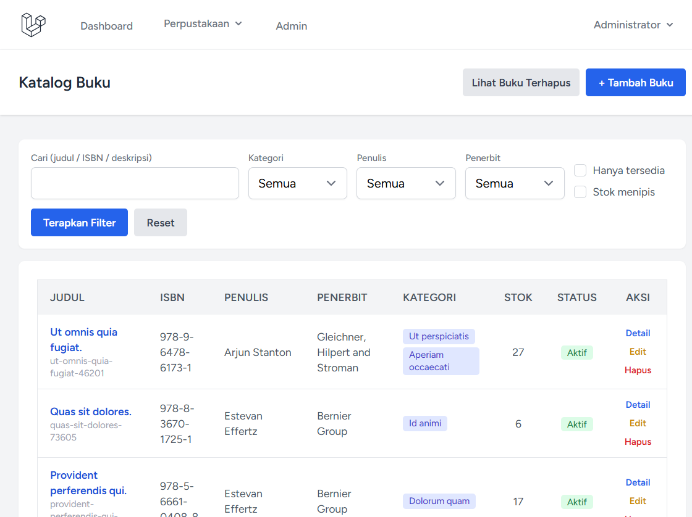

# Sistem Perpustakaan — Modular Monolith Laravel

Aplikasi praktikum **Backend Development Pertemuan 6** yang menerapkan **modular monolith** dan
**Domain-Driven Design (DDD)** pada studi kasus sistem perpustakaan.

Tiga bounded context utama:

- **Catalog** — buku, penulis, penerbit, kategori (self-referencing), dan stok.
- **Membership** — anggota, role, dan riwayat keanggotaan.
- **Circulation** — peminjaman, pengembalian, denda, dan riwayat status.



## Fitur Utama

- Modular monolith dengan provider, migration, route, dan service per bounded context.
- Komunikasi lintas context melalui `BookServiceInterface` dan `MemberServiceInterface` di Shared Kernel.
- Relasi lanjutan:
  - Many-to-Many `Book ↔ Category` dengan pivot `added_at`.
  - Self-referencing `Category → parent/children`.
  - HasMany `Loan → LoanItem` dengan snapshot judul/ISBN.
  - Many-to-Many `Member ↔ Role` dengan pivot `assigned_at`.
- Pencarian dan filter buku menggunakan query scope (`available`, `search`, `inCategory`, `lowStock`).
- Eager loading di seluruh halaman daftar/detail untuk mencegah N+1.
- Transaksi atomik + `lockForUpdate` pada peminjaman; rollback otomatis jika stok tidak cukup.
- Soft delete dan restore untuk buku, anggota, peminjaman, dan kategori.
- Domain event `BookBorrowed` dan `BookReturned` dengan listener log.
- Value Object `ISBN` (validasi checksum ISBN-10/13) dan `Denda` (perhitungan otomatis Rp 1.000/hari).
- Otorisasi: seluruh user terautentikasi dapat membaca; operasi tulis khusus `role:admin`.
- 57 automated test (181 assertion) untuk aturan bisnis utama.

## Persyaratan

- PHP 8.3+ (diuji pada PHP 8.5.0)
- Composer 2.x
- Node.js 20+ (diuji pada Node 24.18.0)
- SQLite (default) atau MySQL/PostgreSQL

## Instalasi

```bash
composer install
copy .env.example .env
php artisan key:generate
php artisan migrate:fresh --seed
npm install
npm run build
php artisan serve
```

Buka `http://127.0.0.1:8000`.

> Windows PowerShell: gunakan `npm.cmd install` dan `npm.cmd run build` jika `npm.ps1` diblokir
> execution policy.

## Akun Demo

| Peran | Email | Password | Akses |
|---|---|---|---|
| Admin | `admin@example.com` | `password123` | Baca + tambah/edit/hapus/restore, pinjam/kembali, bayar denda |
| User | `user@example.com` | `password123` | Baca daftar dan detail |

## Perintah Penting

```bash
# Reset database + data demo
php artisan migrate:fresh --seed

# Menjalankan seluruh test
php artisan test

# Demo perbandingan query N+1 vs eager loading
php artisan library:query-demo

# Daftar route
php artisan route:list
```

## Struktur Modul

```text
app/Modules/
├── Shared/
│   ├── Contracts/
│   │   ├── BookServiceInterface.php
│   │   └── MemberServiceInterface.php
│   └── Exceptions/
├── Catalog/
│   ├── Controllers/  Models/  Requests/  Rules/
│   ├── Services/BookService.php
│   ├── ValueObjects/ISBN.php
│   ├── Migrations/  Providers/  routes/
├── Membership/
│   ├── Controllers/  Models/  Requests/
│   ├── Services/MemberService.php
│   ├── Migrations/  Providers/  routes/
└── Circulation/
    ├── Controllers/  Models/  Requests/
    ├── Events/  Listeners/
    ├── Services/LoanService.php
    ├── ValueObjects/Denda.php
    ├── Migrations/  Providers/  routes/
```

Provider modul didaftarkan pada `bootstrap/providers.php`. Binding contract dilakukan pada
`app/Providers/AppServiceProvider.php`.

## Dokumentasi

| Dokumen | Isi |
|---|---|
| [LAPORAN.md](LAPORAN.md) | Laporan lengkap BAB I–V |
| [LAPORAN.pdf](LAPORAN.pdf) | Versi PDF laporan |
| [docs/ARSITEKTUR.md](docs/ARSITEKTUR.md) | Bounded context, ERD Mermaid, alur lintas context |
| [docs/QUERY_OPTIMIZATION.md](docs/QUERY_OPTIMIZATION.md) | Analisis N+1, sebelum/sesudah, scope |
| [docs/PANDUAN_PENGUJIAN.md](docs/PANDUAN_PENGUJIAN.md) | Panduan setup, uji manual, dan uji otomatis |
| [docs/screenshots](docs/screenshots) | 14 screenshot antarmuka |

## Bukti Pengujian

```text
Tests:    57 passed (181 assertions)
```

Contoh output optimasi query (data demo: 11 peminjaman, 40 buku):

| Skenario | Tanpa eager loading | Dengan eager loading |
|---|---:|---:|
| Daftar peminjaman + item | 12 | 2 |
| Daftar buku + penulis + kategori | 81 | 3 |

Log domain event tersedia di `storage/logs/library-events.log`.

## Lisensi

Proyek ini dibuat untuk keperluan praktikum dan menggunakan lisensi MIT.
