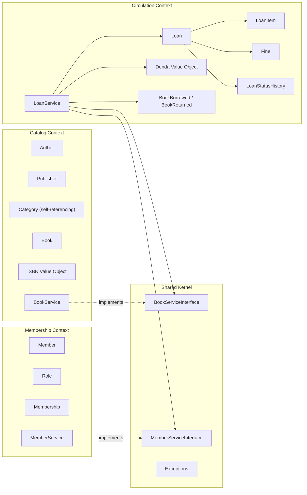
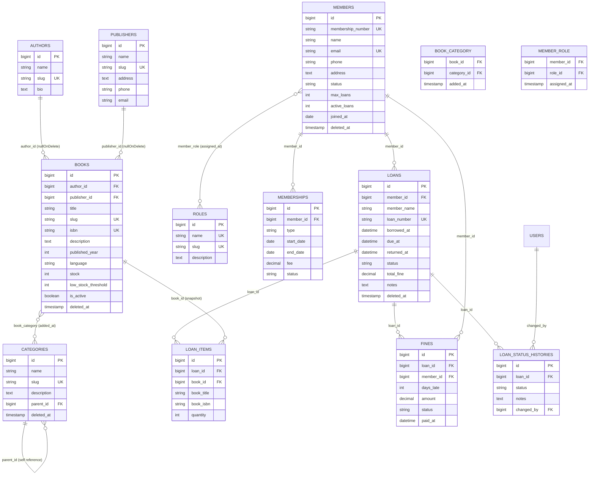
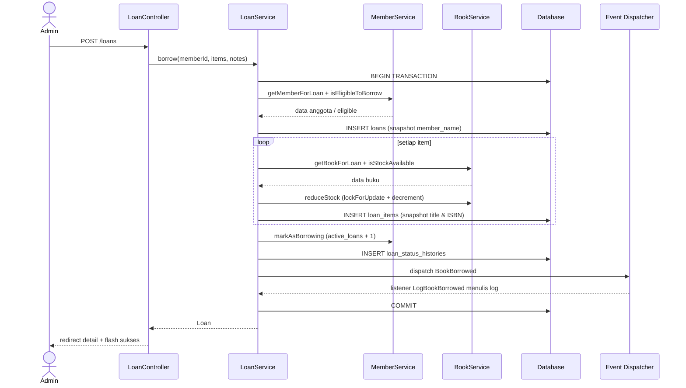

# Arsitektur Sistem Perpustakaan (Modular Monolith + DDD)

Dokumen ini menjelaskan rancangan arsitektur aplikasi **Sistem Perpustakaan** yang dibangun sebagai
**modular monolith** dengan pemisahan **bounded context** sesuai prinsip Domain-Driven Design (DDD).

---

## 1. Prinsip Utama

1. **Satu aplikasi, banyak modul.** Seluruh bounded context berada dalam satu proses Laravel dan satu
   database, tetapi dipisahkan berdasarkan folder, namespace, provider, migration, route, dan service.
2. **Batasan context dijaga oleh contract.** Context `Circulation` tidak boleh mengimpor model
   `Catalog` atau `Membership` secara langsung. Komunikasi lintas context hanya melalui interface di
   `Modules\Shared\Contracts`.
3. **Domain logic berada di domain/service, bukan di controller.** Controller hanya memvalidasi input,
   memanggil service, dan mengembalikan response.
4. **Setiap context memiliki service provider sendiri** yang mendaftarkan migration, route, dan
   binding bila diperlukan.
5. **Perubahan data kritikal bersifat atomik** menggunakan `DB::transaction`.

---

## 2. Peta Bounded Context



### Tanggung jawab tiap context

| Context | Tanggung jawab | Entitas utama |
|---|---|---|
| **Catalog** | Mengelola data bibliografi, stok, kategori, penulis, penerbit, dan ketersediaan buku | `Author`, `Publisher`, `Category`, `Book` |
| **Membership** | Mengelola anggota, role, masa keanggotaan, status, dan batas peminjaman | `Member`, `Role`, `Membership` |
| **Circulation** | Mengelola peminjaman, pengembalian, denda, dan riwayat status | `Loan`, `LoanItem`, `Fine`, `LoanStatusHistory` |
| **Shared Kernel** | Kontrak lintas context dan exception domain | `BookServiceInterface`, `MemberServiceInterface`, 4 exception |
| **Auth** (existing) | Autentikasi Breeze, role user (`admin`/`user`), middleware `role` | `User` |

---

## 3. Struktur Direktori

```text
app/
├── Modules/
│   ├── Shared/
│   │   ├── Contracts/
│   │   │   ├── BookServiceInterface.php
│   │   │   └── MemberServiceInterface.php
│   │   └── Exceptions/
│   │       ├── BookNotAvailableException.php
│   │       ├── InsufficientStockException.php
│   │       ├── LoanAlreadyReturnedException.php
│   │       └── MemberNotEligibleException.php
│   ├── Catalog/
│   │   ├── Controllers/        # Book, Category, Author, Publisher
│   │   ├── Migrations/         # 000101–000105
│   │   ├── Models/             # Author, Publisher, Category, Book
│   │   ├── Providers/          # CatalogServiceProvider
│   │   ├── Requests/           # Store/Update Book & Category
│   │   ├── Rules/              # IsbnRule
│   │   ├── Services/           # BookService
│   │   ├── ValueObjects/       # ISBN
│   │   └── routes/web.php
│   ├── Membership/
│   │   ├── Controllers/        # Member, Membership, Role
│   │   ├── Migrations/         # 000201–000204
│   │   ├── Models/             # Member, Role, Membership
│   │   ├── Providers/          # MembershipServiceProvider
│   │   ├── Requests/           # Store/Update Member, Store Membership
│   │   ├── Services/           # MemberService
│   │   └── routes/web.php
│   └── Circulation/
│       ├── Controllers/        # Loan, Fine
│       ├── Events/             # BookBorrowed, BookReturned
│       ├── Listeners/          # LogBookBorrowed, LogBookReturned
│       ├── Migrations/         # 000301–000304
│       ├── Models/             # Loan, LoanItem, Fine, LoanStatusHistory
│       ├── Providers/          # CirculationServiceProvider
│       ├── Requests/           # StoreLoanRequest
│       ├── Services/           # LoanService
│       ├── ValueObjects/       # Denda
│       └── routes/web.php
├── Providers/
│   └── AppServiceProvider.php  # binding contract + factory resolver
└── Console/Commands/
    └── QueryOptimizationDemo.php
```

Migration setiap context didaftarkan oleh provider masing-masing melalui `loadMigrationsFrom()`,
sehingga `php artisan migrate` tetap menjalankan seluruh skema tanpa perlu menyalin file ke
`database/migrations`.

---

## 4. Entity Relationship Diagram (ERD)



### Relasi lanjutan yang dipenuhi

| Kebutuhan modul | Implementasi | Bukti |
|---|---|---|
| Many-to-Many dengan pivot tambahan | `Book::categories()` ↔ `Category::books()`, pivot `book_category` berisi `added_at` | Halaman detail buku menampilkan `added_at`; form buku menampilkan checkbox kategori |
| Self-referencing | `Category::parent()` (`belongsTo`) dan `Category::children()` (`hasMany`) | Halaman kategori menampilkan kolom Induk/Sub-kategori |
| HasMany | `Loan::items()` → `LoanItem`, `Loan::fines()`, `Loan::statusHistories()` | Detail peminjaman menampilkan daftar item dan riwayat status |
| Many-to-Many kedua | `Member::roles()` ↔ `Role::members()`, pivot `member_role` berisi `assigned_at` | Halaman detail anggota menampilkan checkbox role |

---

## 5. Alur Lintas Context

### 5.1 Peminjaman (`LoanService::borrow`)



Jika stok tidak mencukupi, `InsufficientStockException` dilempar **sebelum COMMIT**, sehingga
`DB::transaction()` melakukan rollback seluruh perubahan (loan, item, stok, status anggota).

### 5.2 Pengembalian (`LoanService::returnBook`)

1. `BEGIN TRANSACTION`
2. Ambil loan beserta item; tolak jika sudah berstatus `returned`.
3. Kembalikan stok setiap item melalui `BookService::increaseStock()` (memakai `withTrashed()`
   agar buku yang sudah di-soft-delete tetap dapat dikembalikan stoknya).
4. Hitung denda dengan `Denda::between($due_at, $returned_at)`.
5. Buat `Fine` bila terlambat, update `loans.status`, `returned_at`, `total_fine`.
6. `MemberService::markAsReturned()` menurunkan `active_loans` dan mengembalikan status ke
   `active` hanya jika sebelumnya `borrowing`.
7. Catat `LoanStatusHistory`, dispatch `BookReturned`, lalu `COMMIT`.

---

## 6. Keputusan Desain

| Keputusan | Alasan |
|---|---|
| **Contract di Shared Kernel** | Mencegah Circulation bergantung pada model internal Catalog/Membership; mudah diuji dan diganti implementasinya |
| **Snapshot `member_name`, `book_title`, `book_isbn`** | Riwayat peminjaman tetap akurat walau data master berubah atau dihapus |
| **Soft delete pada Book, Member, Loan, Category** | Data historis tidak hilang; admin dapat melakukan restore |
| **Transaksi + `lockForUpdate`** | Mencegah stok minus dan race condition saat dua admin meminjam buku yang sama |
| **Value Object `ISBN`** | Validasi checksum ISBN-10/13 dan normalisasi input terpusat |
| **Value Object `Denda`** | Perhitungan denda otomatis, konsisten, dan mudah diuji tanpa database |
| **Domain event** | Memisahkan aksi bisnis dari efek samping (logging/notifikasi) |
| **Route admin didaftarkan lebih dulu** | Mencegah `/books/create` tertangkap oleh `/books/{book}` |
| **Eager loading + scope** | Menghindari N+1 dan menyederhanakan filter |

---

## 7. Matriks Akses Route

| Route | Method | Admin | User terautentikasi |
|---|---|:---:|:---:|
| `/books`, `/books/{book}` | GET | ✅ | ✅ |
| `/books/create`, `/books/{book}/edit` | GET | ✅ | ❌ 403 |
| `/books` (store), `/books/{book}` (update/delete) | POST/PUT/DELETE | ✅ | ❌ 403 |
| `/books/{id}/restore` | POST | ✅ | ❌ 403 |
| `/categories`, `/authors`, `/publishers` | GET | ✅ | ✅ |
| CRUD kategori/penulis/penerbit | POST/PUT/DELETE | ✅ | ❌ 403 |
| `/members`, `/members/{member}`, `/roles` | GET | ✅ | ✅ |
| CRUD anggota/role/keanggotaan | POST/PUT/DELETE | ✅ | ❌ 403 |
| `/loans`, `/loans/{loan}`, `/fines` | GET | ✅ | ✅ |
| Buat/kembalikan/hapus/restore peminjaman, bayar denda | POST/DELETE | ✅ | ❌ 403 |

Middleware yang digunakan: `auth` untuk seluruh route, dan `role:admin` untuk operasi tulis.

---

## 8. Ringkasan Bukti Teknis

| Aspek | Lokasi bukti |
|---|---|
| Kontrak lintas context | `app/Modules/Shared/Contracts/` |
| Binding contract | `app/Providers/AppServiceProvider.php` |
| Transaksi & rollback | `app/Modules/Circulation/Services/LoanService.php` |
| Value Object ISBN | `app/Modules/Catalog/ValueObjects/ISBN.php` |
| Value Object Denda | `app/Modules/Circulation/ValueObjects/Denda.php` |
| Domain event & listener | `app/Modules/Circulation/Events/`, `app/Modules/Circulation/Listeners/` |
| Log event | `storage/logs/library-events.log` |
| Demo query | `php artisan library:query-demo` |
| Automated test | `tests/Unit/`, `tests/Feature/Library/` |
| Screenshot UI | `docs/screenshots/` |
